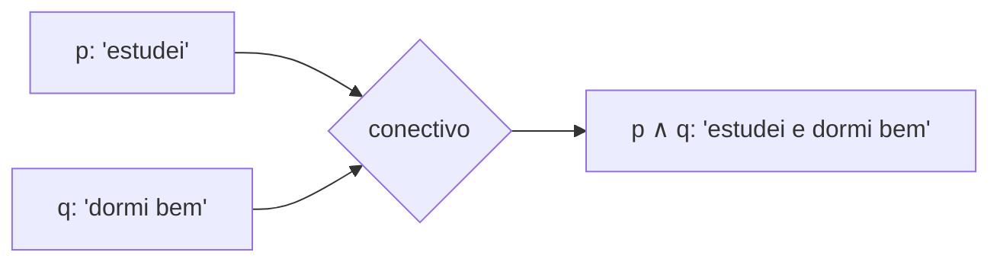

# 03. Fundamentos de lógica

!!! info "Nesta aula"
    - O que é uma **proposição** (e o que não é).
    - Proposições simples vs. compostas.
    - Por que lógica formal importa para quem programa.
    - Prévia dos conectivos que vamos formalizar na próxima aula.

## 🧠 O que é lógica, afinal?

**Lógica** é o estudo do raciocínio válido: como partir de afirmações que
aceitamos como verdadeiras e chegar a conclusões corretas, **sem depender do
assunto** de que estamos falando. Na Computação, lógica formal é a base de:

- condições (`if`, `while`);
- consultas a banco de dados (`WHERE idade > 18 AND ativo = true`);
- circuitos digitais (a matéria-prima do hardware);
- verificação de programas (provar que um código faz o que promete).

## 📣 O que é uma proposição

Uma **proposição** é uma sentença declarativa à qual podemos atribuir
**exatamente um** valor lógico: **verdadeiro (V)** ou **falso (F)** — nunca os
dois, nunca nenhum.

!!! example "É proposição?"
    | Sentença | É proposição? | Por quê |
    | :--- | :---: | :--- |
    | "2 + 2 = 4" | ✅ | Declarativa, valor V definido |
    | "Brasília é a capital do Brasil" | ✅ | Declarativa, valor V definido |
    | "Está chovendo em São Paulo agora" | ✅ | Tem valor V/F, mesmo que você não saiba qual |
    | "Feche a porta!" | ❌ | É uma ordem, não afirma nada |
    | "Qual é o seu nome?" | ❌ | É uma pergunta |
    | "$x + 1 = 5$" | ❌ | Depende de $x$ — só vira proposição quando $x$ é fixado |
    | "Esta frase é falsa" | ❌ | Paradoxo: não tem um valor V/F consistente |

!!! note "Sentenças abertas"
    "$x + 1 = 5$" é uma **sentença aberta** (tem uma variável livre). Ela vira
    proposição só quando substituímos $x$ por um valor específico: para
    $x = 4$ ela é V; para $x = 0$ ela é F.

!!! example "Mais exemplos do dia a dia"
    | Sentença | É proposição? | Por quê |
    | :--- | :---: | :--- |
    | "Todo número par é divisível por 2" | ✅ | Declarativa, valor V definido (é sempre verdadeira) |
    | "$n$ é um número primo" | ❌ | Sentença aberta — depende do valor de $n$ |
    | "Uau, que prova difícil!" | ❌ | Exclamação, não afirma um fato com valor V/F |
    | "O Sol é uma estrela e a Lua é um planeta" | ✅ | Declarativa **composta**: a primeira parte é V, a segunda é F, então a sentença toda é **falsa** |

    O último exemplo já antecipa a próxima aula: uma proposição composta com
    "e" só é verdadeira quando **as duas partes** são verdadeiras.

## 🧩 Proposições simples vs. compostas

- **Proposição simples (atômica)**: não pode ser dividida em partes menores
  com sentido próprio. Ex.: "chove", "estudo".
- **Proposição composta (molecular)**: formada por proposições simples unidas
  por **conectivos**. Ex.: "chove **e** estudo".

Representamos proposições por letras minúsculas — $p$, $q$, $r$ — e os
conectivos combinam essas letras em fórmulas maiores, do mesmo jeito que
operadores combinam números em expressões aritméticas.



## 🐍 Isso já existe no seu código

Em Python, toda expressão que resulta em `True`/`False` **é** uma proposição
(com $x$ já substituído):

```python
idade = 20
ativo = True

maior_de_idade = idade >= 18      # proposição: True
pode_acessar = maior_de_idade and ativo   # proposição composta
print(pode_acessar)  # True
```

`idade >= 18` só é proposição depois que `idade` tem um valor — exatamente
como "$x + 1 = 5$" só vira proposição quando $x$ é fixado.

!!! example "Mesma ideia, outro contexto: validação de senha"
    ```python
    senha = "abc12345"

    tem_8_caracteres = len(senha) >= 8          # proposição
    tem_numero = any(c.isdigit() for c in senha) # proposição

    senha_valida = tem_8_caracteres and tem_numero  # proposição composta
    print(senha_valida)  # True
    ```
    Cada `if` de validação que você já escreveu era, sem que você chamasse
    assim, uma combinação de proposições.

## 🔮 Prévia: os conectivos

Na próxima aula vamos formalizar cinco conectivos e suas **tabelas-verdade**:
negação ($\neg$), conjunção ($\wedge$, "e"), disjunção ($\vee$, "ou"),
condicional ($\to$, "se...então") e bicondicional ($\leftrightarrow$, "se e
somente se"). Eles são o equivalente lógico de `not`, `and`, `or` e das
condições que você já escreve em código.

## 📝 Exercícios

??? abstract "Exercício 1 — Proposição ou não?"
    Classifique cada sentença como proposição ou não, justificando:
    (a) "O número 7 é primo."; (b) "Ajude-me com a lista!"; (c) "$n$ é par.";
    (d) "Ou está frio ou não está."

??? abstract "Exercício 2 — Simples ou composta?"
    Das sentenças do Exercício 1 que **são** proposições, quais são simples e
    quais são compostas? Identifique os conectivos nas compostas.

??? abstract "Exercício 3 — Sentença aberta"
    Para a sentença aberta "$x^2 = 9$", dê um valor de $x$ que a torne
    verdadeira e outro que a torne falsa.

??? abstract "Exercício 4 — Desafio"
    Volte ao [desafio da Busca Ativa (Aula 02)](02-aula.md). Escreva, em
    português formal, as três pistas do problema como proposições (simples
    ou compostas) usando as letras $A$ = "Ana está de pirata", e assim por
    diante.

## 📚 Referências

**Livros (teoria)**

- ROSEN, K. H. *Matemática Discreta e suas Aplicações*. 7. ed. Porto Alegre:
  AMGH/McGraw-Hill — cap. **Lógica Proposicional** (introdução).
- GERSTING, J. L. *Fundamentos Matemáticos para a Ciência da Computação*.
  7. ed. LTC — cap. **Lógica**.
- COPI, I. M.; COHEN, C. *Introdução à Lógica*. Mestre Jou — capítulos
  iniciais sobre proposições e argumentos.

**Documentação e prática (Python)**

- Python — expressões booleanas e operadores de comparação:
  <https://docs.python.org/3/library/stdtypes.html#comparisons>
- Python — operadores booleanos `and`/`or`/`not`:
  <https://docs.python.org/3/reference/expressions.html#boolean-operations>

**🎥 Vídeos**

- Canal **Me Salva!** — vídeos introdutórios sobre lógica proposicional e
  raciocínio lógico:
  <https://www.youtube.com/results?search_query=me+salva+l%C3%B3gica+proposicional>
- Vídeos sobre "raciocínio lógico para concursos" (ótimos para fixar o
  conceito de proposição com muitos exemplos práticos):
  <https://www.youtube.com/results?search_query=raciocinio+logico+proposi%C3%A7%C3%B5es+o+que+%C3%A9>

!!! tip "Próxima Parada 🚏"
    Vamos formalizar os conectivos em
    **[Proposições lógicas e tabela-verdade dos conectivos](04-aula.md)**.
