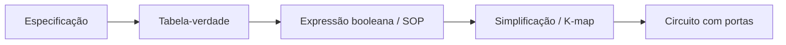
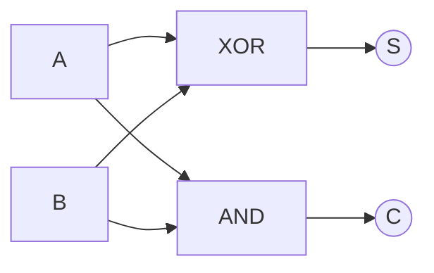
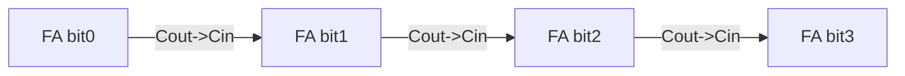

# 09. Introdução a circuitos digitais

!!! info "Nesta aula"
    - Portas lógicas e seus símbolos.
    - Da tabela-verdade ao circuito.
    - Meio somador (half adder).
    - Por que álgebra booleana é a base do hardware.

## 🔌 Portas lógicas

Cada operação booleana da [Aula 06](06-aula.md) vira uma **porta** física:

| Porta | Símbolo | Função |
| :--- | :--- | :--- |
| AND | ∧ | 1 só se **todas** entradas = 1 |
| OR | ∨ | 1 se **alguma** entrada = 1 |
| NOT | ¬ | inverte |
| NAND | ⊼ | NOT(AND) |
| NOR | ⊽ | NOT(OR) |
| XOR | ⊕ | 1 se entradas **diferentes** |

!!! note "NAND é universal"
    Qualquer circuito pode ser construído **só com portas NAND** (ou só NOR).
    Isso simplifica a fabricação de chips: uma linha de produção especializada
    numa única porta.

### Por que NAND é universal

Escrevendo $\text{NAND}(x,y) = \overline{x \cdot y}$, conseguimos montar NOT,
AND e OR só com ela:

| Porta | Construção com NAND | Ideia |
| :--- | :--- | :--- |
| NOT | $\overline{x} = \text{NAND}(x, x)$ | $\overline{x \cdot x} = \overline{x}$ |
| AND | $x \cdot y = \text{NAND}(\text{NAND}(x,y),\ \text{NAND}(x,y))$ | NAND seguido de NOT |
| OR | $x + y = \text{NAND}(\overline{x}, \overline{y})$ | De Morgan: $\overline{\overline{x}\cdot\overline{y}} = x+y$ |

## 🛠️ Da lógica ao circuito

Um circuito **combinacional** implementa uma função booleana. O fluxo de
projeto conecta tudo o que vimos até aqui:



## ➕ Meio somador (Half Adder)

Soma dois bits $A$ e $B$, produzindo a soma $S$ e o "vai-um" (carry) $C$:

| $A$ | $B$ | $S$ | $C$ |
| :-: | :-: | :-: | :-: |
| 0 | 0 | 0 | 0 |
| 0 | 1 | 1 | 0 |
| 1 | 0 | 1 | 0 |
| 1 | 1 | 0 | 1 |

Das colunas saem as expressões:

$$S = A \oplus B \qquad C = A \cdot B$$



!!! example "Reconhecendo a estrutura"
    Note que $S$ é exatamente o **XOR** que já vimos ([Aula 06](06-aula.md)) e
    $C$ é um simples **AND**. O meio somador nada mais é do que duas portas
    já conhecidas, combinadas.

## 🐍 Simulando o meio somador em Python

```python
def half_adder(a, b):
    soma  = a ^ b        # XOR
    carry = a & b        # AND
    return soma, carry

for a in (0, 1):
    for b in (0, 1):
        print(a, b, "->", half_adder(a, b))
```

## ➕➕ Somador completo (Full Adder)

O meio somador não considera um "vai-um" de **entrada**. O **somador
completo** (full adder) soma dois bits $A$, $B$ **mais** um carry de entrada
$C_{in}$, produzindo soma $S$ e carry de saída $C_{out}$:

| $A$ | $B$ | $C_{in}$ | $S$ | $C_{out}$ |
| :-: | :-: | :-: | :-: | :-: |
| 0 | 0 | 0 | 0 | 0 |
| 0 | 0 | 1 | 1 | 0 |
| 0 | 1 | 0 | 1 | 0 |
| 0 | 1 | 1 | 0 | 1 |
| 1 | 0 | 0 | 1 | 0 |
| 1 | 0 | 1 | 0 | 1 |
| 1 | 1 | 0 | 0 | 1 |
| 1 | 1 | 1 | 1 | 1 |

Das colunas saem as expressões:

$$S = A \oplus B \oplus C_{in} \qquad C_{out} = AB + C_{in}(A \oplus B)$$

!!! example "Construindo com dois meios somadores"
    $$S = \underbrace{A \oplus B}_{\text{1º half adder}} \oplus\, C_{in}
    \qquad
    C_{out} = \underbrace{AB}_{\text{carry do 1º}} + \underbrace{C_{in}(A \oplus B)}_{\text{carry do 2º}}$$
    Ou seja: o full adder é literalmente **dois** `half_adder` encadeados,
    mais um OR para combinar os dois carries — exatamente o que você vai
    implementar no Exercício 4.

Encadeando $n$ full adders (o $C_{out}$ de um vira o $C_{in}$ do próximo),
construímos somadores de $n$ bits — a base da **ULA** (unidade lógica e
aritmética) de qualquer processador.



## 🌍 Aplicações

- **ULA/CPU:** somadores, comparadores e multiplexadores são circuitos
  booleanos.
- **Memórias e registradores:** portas realimentadas guardam bits.
- **Controle:** decodificadores traduzem instruções em sinais.

## 📝 Exercícios

??? abstract "Exercício 1"
    Desenhe (ou descreva) o circuito de
    $f = \overline{A}\cdot B + A\cdot\overline{B}$. Que porta única equivale
    a ele?

??? abstract "Exercício 2"
    Monte a tabela-verdade do **meio somador** e confira contra a função
    Python da aula.

??? abstract "Exercício 3"
    Mostre que NAND é universal: implemente NOT, AND e OR usando **apenas**
    NAND, em Python (defina só `def nand(x, y): return 1 - (x & y)` e
    construa o resto a partir dela).

??? abstract "Exercício 4 — Desafio"
    Implemente `full_adder(a, b, carry_in)` encadeando duas chamadas de
    `half_adder`. Teste todas as 8 combinações de `a`, `b`, `carry_in`.

## 📚 Referências

**Livros (teoria)**

- TOCCI, R. J.; WIDMER, N. S.; MOSS, G. L. *Sistemas Digitais: princípios e
  aplicações*. Pearson — **portas lógicas e circuitos combinacionais**.
- IDOETA, I. V.; CAPUANO, F. G. *Elementos de Eletrônica Digital*. Érica —
  cap. **Circuitos combinacionais** (meio somador e somador completo).
- NISAN, N.; SCHOCKEN, S. *The Elements of Computing Systems* (Nand2Tetris) —
  construindo um computador a partir de portas NAND:
  <https://www.nand2tetris.org/>

**Documentação e prática (Python)**

- Python — operadores bit a bit (`^`, `&`, `|`): <https://docs.python.org/3/reference/expressions.html#binary-bitwise-operations>

**🎥 Vídeos**

- **Ben Eater** — construção de um computador de 8 bits em hardware real,
  ótimo para visualizar portas lógicas viram circuitos de verdade:
  <https://www.youtube.com/results?search_query=ben+eater+8+bit+computer+logic+gates>
- **Nand2Tetris** — vídeo-aula sobre construir um half adder e full adder a
  partir de portas NAND:
  <https://www.youtube.com/results?search_query=nand2tetris+half+adder+full+adder>
- **Computerphile** — explicações de portas lógicas e por que NAND é
  universal:
  <https://www.youtube.com/results?search_query=computerphile+logic+gates+nand>

!!! tip "Próxima Parada 🚏"
    Nosso próximo encontro é a
    **[Busca Ativa — Meio de Semestre](10-aula.md)**. Depois seguimos para
    mais uma **[aula de atividades/prática](11-aula.md)**.
