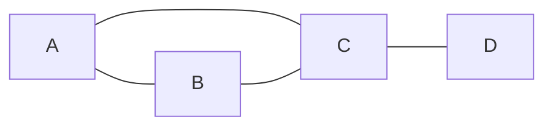

# 12. Introdução a Grafos

!!! info "Nesta aula"
    - Pares ordenados e relações — o mínimo necessário para grafos.
    - O que é um grafo: vértices, arestas e tipos.
    - Representações: lista e matriz de adjacência.
    - Grau, caminho e ciclo.

## 🔗 O mínimo de "relações" para começar

Um **par ordenado** $(a, b)$ registra dois elementos **em ordem** — diferente
de conjuntos, aqui $(a,b) \neq (b,a)$ (a menos que $a=b$). Uma **relação**
entre elementos de um conjunto $V$ é simplesmente um conjunto de pares
ordenados $(a,b)$ com $a, b \in V$.

Isso é exatamente o que precisamos para grafos: um grafo é uma relação
(as arestas) sobre um conjunto (os vértices), desenhada como pontos e linhas
em vez de escrita como pares.

## 🕸️ O que é um grafo

Um **grafo** $G = (V, E)$ é um conjunto de **vértices** $V$ e um conjunto de
**arestas** $E$ (pares de vértices) que os conectam. É a estrutura ideal para
modelar **relações**: redes sociais, mapas, dependências entre tarefas.



=== "Não dirigido"
    Arestas sem direção: se $A$–$B$, então $B$–$A$. (amizades)

=== "Dirigido (dígrafo)"
    Arestas com seta: $A \to B$ não implica $B \to A$. (seguidores, links)

=== "Ponderado"
    Arestas têm **peso** (custo/distância). (mapas rodoviários)

!!! example "Um grafo concreto: rede de amigos"
    Ana, Bruno, Caio e Duda numa rede social **não dirigida** (amizade é
    mútua): Ana–Bruno, Ana–Caio, Bruno–Caio, Caio–Duda.

    - **Como lista de arestas:** $E = \{\{Ana,Bruno\}, \{Ana,Caio\},
      \{Bruno,Caio\}, \{Caio,Duda\}\}$ — a forma mais compacta de descrever
      um grafo, útil para arquivos de entrada de algoritmos.
    - Note que é o **mesmo grafo** do diagrama Mermaid logo acima, só com
      nomes em vez de letras.

!!! example "Grafo ponderado: rotas entre cidades"
    Um mapa rodoviário é um grafo ponderado: vértices são cidades, arestas
    são estradas, e o peso é a distância em km. Se São Paulo–Campinas tem
    peso 95 e Campinas–Ribeirão Preto tem peso 120, o **caminho mais curto**
    de São Paulo a Ribeirão Preto via Campinas custa $95+120=215$ km — é
    exatamente esse tipo de soma que algoritmos como o de Dijkstra otimizam.

!!! example "Grafo dirigido é uma relação, literalmente"
    O grafo dirigido com $V=\{A,B,C\}$ e arestas $A\to B$, $B\to C$ **é** a
    relação $R = \{(A,B), (B,C)\}$ sobre $V$. Um grafo não dirigido é uma
    relação **simétrica**: se $(A,B) \in R$, então $(B,A) \in R$ também.

## 🔢 Conceitos-chave

| Termo | Significado |
| :--- | :--- |
| **Grau** de $v$ | nº de arestas incidentes em $v$ |
| **Caminho** | sequência de vértices ligados por arestas |
| **Ciclo** | caminho que começa e termina no mesmo vértice |
| **Conexo** | existe caminho entre quaisquer dois vértices |

!!! note "Handshake Lemma"
    A soma dos graus de todos os vértices é o **dobro** do número de arestas:
    $\sum_{v \in V} \deg(v) = 2\lvert E \rvert$. Cada aresta "toca" dois
    vértices, então é contada duas vezes na soma dos graus.

!!! example "Grau a partir da matriz de adjacência"
    Num grafo não dirigido, o **grau** de um vértice é a soma da sua linha na
    matriz de adjacência. Para o ciclo $V=\{1,2,3,4\}$ com
    $E=\{\{1,2\},\{2,3\},\{3,4\},\{4,1\}\}$, cada vértice tem grau 2, então
    $\sum \deg(v) = 8 = 2\cdot 4$ (4 arestas). ✅ Handshake Lemma.

## 🗂️ Como representar um grafo

=== "Lista de adjacência"
    Para cada vértice, a lista de vizinhos. Boa para grafos **esparsos**.

    ```python
    grafo = {
        "A": ["B", "C"],
        "B": ["A", "C"],
        "C": ["A", "B", "D"],
        "D": ["C"],
    }
    ```

=== "Matriz de adjacência"
    Matriz $n \times n$ onde $M_{ij} = 1$ se há aresta $i$–$j$. Boa para
    grafos **densos**.

    ```python
    #     A  B  C  D
    M = [[0, 1, 1, 0],   # A
         [1, 0, 1, 0],   # B
         [1, 1, 0, 1],   # C
         [0, 0, 1, 0]]   # D
    ```

## 🐍 Testando propriedades em Python

```python
def grau(grafo, v):
    return len(grafo[v])

def eh_conexo(grafo):
    inicio = next(iter(grafo))
    visitados = {inicio}
    fronteira = [inicio]
    while fronteira:
        v = fronteira.pop()
        for vizinho in grafo[v]:
            if vizinho not in visitados:
                visitados.add(vizinho)
                fronteira.append(vizinho)
    return visitados == set(grafo)

grafo = {"A": ["B", "C"], "B": ["A", "C"], "C": ["A", "B", "D"], "D": ["C"]}
print(grau(grafo, "C"))     # 3
print(eh_conexo(grafo))     # True
```

## 🌍 Onde grafos aparecem

- Redes sociais (quem segue quem), mapas (cidades e estradas).
- Dependências entre tarefas ou pacotes de software.
- Redes de computadores, circuitos ([Aula 09](09-aula.md)) e — como veremos —
  **árvores** ([Aula 14](14-aula.md)), um caso especial de grafo.

## 📝 Exercícios

??? abstract "Exercício 1"
    Escreva o grafo $V=\{1,2,3,4\}$, $E=\{\{1,2\},\{2,3\},\{3,4\},\{4,1\}\}$
    como um conjunto de pares ordenados (trate como não dirigido, listando
    os dois sentidos). Ele é conexo? Tem ciclo?

??? abstract "Exercício 2"
    Escreva a **matriz de adjacência** do grafo do Exercício 1 e some os
    graus. Confirme o Handshake Lemma.

??? abstract "Exercício 3"
    Um grafo dirigido tem arestas $A\to B$, $B \to C$, $C \to A$. Ele
    representa uma relação simétrica? Justifique usando a definição de par
    ordenado.

??? abstract "Exercício 4 — Desafio"
    Implemente `tem_ciclo(grafo)` para um grafo não dirigido representado
    como lista de adjacência (dica: uma busca que rejeita voltar direto para
    o vértice anterior, mas aceita revisitar por outro caminho).

## 📚 Referências

**Livros (teoria)**

- ROSEN, K. H. *Matemática Discreta e suas Aplicações*. 7. ed. AMGH/McGraw-Hill
  — cap. **Grafos**.
- GERSTING, J. L. *Fundamentos Matemáticos para a Ciência da Computação*.
  7. ed. LTC — cap. **Grafos e Árvores**.
- GOODRICH, M. T.; TAMASSIA, R. *Estruturas de Dados e Algoritmos em Python*.
  Bookman — **representação de grafos**.

**Documentação e prática (Python)**

- NetworkX — biblioteca de grafos: <https://networkx.org/documentation/stable/tutorial.html>

**🎥 Vídeos**

- **Computerphile** — introdução a grafos e suas representações:
  <https://www.youtube.com/results?search_query=computerphile+graphs+data+structure>
- Grafos, matriz e lista de adjacência explicados com exemplos:
  <https://www.youtube.com/results?search_query=grafos+matriz+de+adjacencia+lista+de+adjacencia+exemplos>

!!! tip "Próxima Parada 🚏"
    Vamos aplicar tudo isso na
    **[Atividade avaliativa em grupo](13-aula.md)**.
