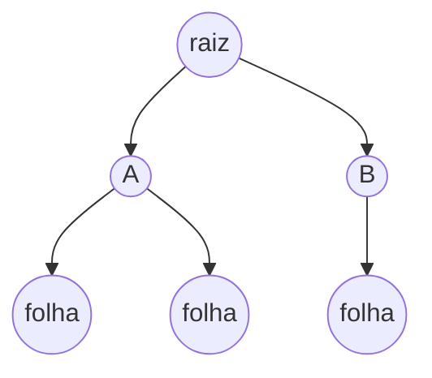
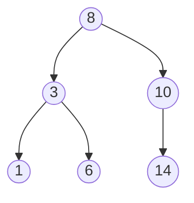

# 14. Estudo de Árvore

!!! info "Nesta aula"
    - Árvore como um grafo especial (conexo e sem ciclos).
    - Terminologia: raiz, folha, altura, profundidade, subárvore.
    - Árvore binária e árvore binária de busca.
    - Percursos: pré-ordem, em-ordem, pós-ordem.

## 🌳 O que é uma árvore

Uma **árvore** é um grafo **conexo e sem ciclos** ([Aula 12](12-aula.md)).
Propriedades importantes:

- Uma árvore com $n$ vértices tem exatamente $n - 1$ arestas.
- Existe **um único caminho** entre quaisquer dois vértices.
- Removendo qualquer aresta, a árvore deixa de ser conexa (se desconecta em
  duas partes).

!!! tip "Contando arestas de uma árvore"
    Como uma árvore com $n$ vértices tem sempre $n-1$ arestas, uma árvore com
    **10 vértices tem 9 arestas** — sem precisar desenhá-la.

## 🏷️ Terminologia de árvore enraizada

Numa árvore **enraizada**, escolhemos um vértice como **raiz** e organizamos
o resto em hierarquia:

| Termo | Significado |
| :--- | :--- |
| **Raiz** | vértice do topo, sem pai |
| **Pai / filho** | relação entre um nó e os nós ligados diretamente abaixo dele |
| **Folha** | nó sem filhos |
| **Profundidade** de um nó | nº de arestas da raiz até ele |
| **Altura** da árvore | maior profundidade entre todas as folhas |
| **Subárvore** | uma árvore "dentro" da árvore, enraizada em qualquer nó |



Aqui a raiz tem profundidade 0, `A` e `B` têm profundidade 1, e as folhas têm
profundidade 2 — logo a **altura** da árvore é 2.

!!! example "Uma árvore não binária do dia a dia: pastas de arquivos"
    ```mermaid
    graph TD
        Docs((Documentos)) --> Fotos((Fotos)) & Trabalho((Trabalho))
        Fotos --> Ferias((Férias)) & Familia((Família))
        Trabalho --> UC1((UC-MCA)) & UC2((UC-BD))
    ```
    `Documentos` é a raiz, `Fotos` e `Trabalho` têm profundidade 1, e as
    quatro subpastas de nível mais baixo têm profundidade 2. Repare que
    aqui um nó (`Trabalho`) tem **dois** filhos, mas nada impede uma pasta
    real de ter três, quatro ou mais subpastas — diferente da árvore
    **binária** da próxima seção, que limita a **2** filhos por nó.

## 🌲 Árvore binária e árvore binária de busca

Uma **árvore binária** é uma árvore em que cada nó tem **no máximo 2
filhos** (chamados de filho esquerdo e filho direito).

Uma **árvore binária de busca (BST)** é uma árvore binária com uma regra
extra: para todo nó, os valores da **subárvore esquerda** são menores, e os
da **subárvore direita** são maiores. Essa regra é o que permite buscar um
valor em $O(\log n)$ passos, em vez de percorrer todos os $n$ nós.



## 🔁 Percorrendo uma árvore

Existem três formas clássicas de visitar todos os nós:

=== "Pré-ordem"
    Visita o nó, **depois** a esquerda, **depois** a direita.
    Útil para copiar a estrutura da árvore.

=== "Em-ordem"
    Visita a esquerda, **depois** o nó, **depois** a direita.
    Numa BST, isso visita os valores em **ordem crescente**.

=== "Pós-ordem"
    Visita a esquerda, a direita, **depois** o nó.
    Útil para apagar a árvore (filhos antes do pai).

## 🐍 Árvore binária em Python

```python
class No:
    def __init__(self, valor, esquerda=None, direita=None):
        self.valor = valor
        self.esquerda = esquerda
        self.direita = direita

def em_ordem(no, resultado=None):
    if resultado is None:
        resultado = []
    if no is None:
        return resultado
    em_ordem(no.esquerda, resultado)
    resultado.append(no.valor)
    em_ordem(no.direita, resultado)
    return resultado

# Árvore do diagrama acima (BST)
arvore = No(8, No(3, No(1), No(6)), No(10, None, No(14)))
print(em_ordem(arvore))   # [1, 3, 6, 8, 10, 14] -> ordem crescente!
```

!!! tip "Em-ordem confirma que é uma BST"
    Se a travessia **em-ordem** de uma árvore binária não sai em ordem
    crescente, ela **não** satisfaz a propriedade de BST.

!!! example "Pré-ordem e pós-ordem numa árvore menor (para você comparar com o Exercício 3)"
    Para a árvore com raiz `5`, filho esquerdo `2` e filho direito `9`
    (ambos folhas):

    - **Pré-ordem** (nó, esquerda, direita): `[5, 2, 9]`.
    - **Em-ordem** (esquerda, nó, direita): `[2, 5, 9]`.
    - **Pós-ordem** (esquerda, direita, nó): `[2, 9, 5]`.

    Note que as três ordens têm os **mesmos** elementos, só a **posição da
    raiz** muda: primeiro (pré), no meio (em), ou por último (pós). Use essa
    regra de posição da raiz para conferir sua resposta do Exercício 3.

## 🌍 Onde árvores aparecem

- **Sistemas de arquivos** (pastas dentro de pastas).
- **DOM do HTML** (elementos aninhados).
- **Índices de banco de dados** (B-trees).
- **Árvores de decisão** (aprendizado de máquina).

## 📝 Exercícios

??? abstract "Exercício 1"
    Uma árvore tem 15 vértices. Quantas arestas ela possui? Justifique
    usando a propriedade vista na aula.

??? abstract "Exercício 2"
    Para a árvore do diagrama de terminologia (raiz, A, B, três folhas),
    identifique a profundidade de cada nó e a altura da árvore.

??? abstract "Exercício 3"
    Dada a BST com raiz 8, filho esquerdo 3 (com filhos 1 e 6) e filho
    direito 10 (com filho direito 14), escreva a ordem de visita em
    **pré-ordem** e em **pós-ordem** (a em-ordem já está na aula).

??? abstract "Exercício 4 — Desafio"
    Implemente `pre_ordem(no)` e `pos_ordem(no)` em Python, seguindo o mesmo
    padrão de `em_ordem` da aula. Teste com a árvore de exemplo.

## 📚 Referências

**Livros (teoria)**

- ROSEN, K. H. *Matemática Discreta e suas Aplicações*. 7. ed. AMGH/McGraw-Hill
  — cap. **Árvores**.
- CORMEN, T. H. et al. *Algoritmos: Teoria e Prática* (CLRS). Elsevier — cap.
  **Árvores binárias de busca**.
- GOODRICH, M. T.; TAMASSIA, R. *Estruturas de Dados e Algoritmos em Python*.
  Bookman — **árvores e percursos**.

**Documentação e prática (Python)**

- Python — recursão (funções que chamam a si mesmas): <https://docs.python.org/3/tutorial/controlflow.html#defining-functions>

**🎥 Vídeos**

- Árvores binárias de busca explicadas com animações:
  <https://www.youtube.com/results?search_query=%C3%A1rvore+bin%C3%A1ria+de+busca+anima%C3%A7%C3%A3o+explica%C3%A7%C3%A3o>
- Percursos pré-ordem, em-ordem e pós-ordem passo a passo:
  <https://www.youtube.com/results?search_query=percurso+pre+ordem+em+ordem+pos+ordem+arvore+binaria>

!!! tip "Próxima Parada 🚏"
    Fechamos a disciplina conectando tudo isso a
    **[Matemática em estrutura de dados e na aplicação em algoritmos](15-aula.md)**.
