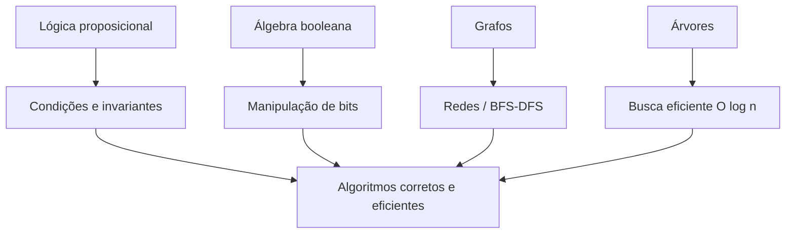

# 15. Matemática em estrutura de dados e na aplicação em algoritmos

!!! info "Nesta aula"
    - Como lógica, álgebra booleana, grafos e árvores viram estruturas de
      dados.
    - Uma primeira ideia de **complexidade de algoritmos** (notação O).
    - Fechamento da disciplina: o que vem a seguir.

## 🧵 Amarrando o fio da meada

Cada tema desta disciplina é, na prática, uma **estrutura de dados ou uma
ferramenta de análise** que você vai usar (e ver formalizada) em disciplinas
futuras de Estrutura de Dados e Algoritmos:

| Tema da disciplina | Vira, na prática... |
| :--- | :--- |
| [Lógica proposicional](04-aula.md) | condições (`if`), invariantes de laço, pré/pós-condições |
| [Álgebra booleana](06-aula.md) | manipulação de bits, *flags*, otimizações de baixo nível |
| [Circuitos digitais](09-aula.md) | por que o hardware "entende" o código que você escreve |
| [Grafos](12-aula.md) | redes, mapas, dependências, algoritmos de busca (BFS/DFS) |
| [Árvores](14-aula.md) | listas ordenadas eficientes (BST), hierarquias, parsing |

## 🧱 De grafos e árvores a estruturas de dados

Uma **estrutura de dados** é uma forma organizada de guardar informação para
que certas operações sejam rápidas. Muitas das mais usadas **são** grafos ou
árvores por baixo dos panos:

- **Lista/pilha/fila**: sequências lineares — o caso mais simples de grafo
  (cada elemento aponta só para o próximo).
- **Árvore binária de busca**: já vista na [Aula 14](14-aula.md) — busca,
  inserção e remoção em $O(\log n)$ no caso médio, contra $O(n)$ de uma lista.
- **Grafo de adjacência**: representa redes diretamente ([Aula 12](12-aula.md))
  — a base de algoritmos de rotas, recomendação e redes sociais.



## ⏱️ Uma primeira ideia de complexidade

Quando comparamos duas formas de resolver o mesmo problema, contamos **quantas
operações** cada uma faz conforme o tamanho da entrada $n$ cresce. Essa
contagem é exatamente o tipo de raciocínio matemático que praticamos o
semestre inteiro — só que aplicado a **algoritmos**, não a tabelas-verdade.

!!! example "Buscar um valor: lista vs. árvore binária de busca"
    - Numa **lista** de $n$ elementos, buscar um valor no pior caso exige
      olhar **todos** os $n$ elementos: $O(n)$.
    - Numa **árvore binária de busca balanceada** com $n$ elementos, cada
      comparação **elimina metade** dos candidatos restantes — o mesmo
      princípio de "descartar metade" de um mapa de Karnaugh bem agrupado.
      Isso leva a $O(\log n)$ comparações.

    Para $n = 1\,000\,000$: a lista pode exigir 1 milhão de comparações; a
    árvore balanceada, cerca de **20**.

```python
def busca_lista(lista, alvo):
    comparacoes = 0
    for item in lista:
        comparacoes += 1
        if item == alvo:
            return comparacoes
    return comparacoes

def busca_bst(no, alvo, comparacoes=0):
    comparacoes += 1
    if no is None or no.valor == alvo:
        return comparacoes
    if alvo < no.valor:
        return busca_bst(no.esquerda, alvo, comparacoes)
    return busca_bst(no.direita, alvo, comparacoes)
```

!!! example "Complexidades comuns, do melhor para o pior caso"
    | Notação | Nome | Exemplo de operação |
    | :--- | :--- | :--- |
    | $O(1)$ | constante | acessar um elemento de uma lista pelo índice |
    | $O(\log n)$ | logarítmica | buscar num valor numa BST balanceada |
    | $O(n)$ | linear | percorrer uma lista inteira (BFS/DFS também são $O(V+E)$) |
    | $O(n \log n)$ | quasilinear | ordenar uma lista com um bom algoritmo de ordenação |
    | $O(n^2)$ | quadrática | comparar cada elemento de uma lista com todos os outros |

    Quanto mais à direita na tabela, mais devagar o algoritmo fica conforme
    $n$ cresce. A diferença entre $O(n)$ e $O(n^2)$ parece pequena para
    $n=10$, mas para $n=1\,000\,000$ é a diferença entre 1 milhão e 1
    **trilhão** de operações.

!!! tip "Notação O é sobre crescimento, não sobre um caso só"
    $O(n)$ e $O(\log n)$ descrevem como o **número de operações cresce**
    conforme $n$ cresce — não quantas operações acontecem para um $n$
    específico. É a mesma ideia de generalizar que usamos ao provar que
    "toda árvore com $n$ vértices tem $n-1$ arestas": vale para **qualquer**
    $n$, não só para o exemplo desenhado.

## 🔍 BFS e DFS: dois algoritmos que você já entende

Percorrer um grafo por **camadas** (BFS) ou "até o fim de um ramo" (DFS) —
que vimos de relance na [Aula 12](12-aula.md) — são os dois algoritmos mais
básicos de estruturas de dados sobre grafos:

```python
from collections import deque

def bfs(grafo, inicio):
    visitados, fila, ordem = {inicio}, deque([inicio]), []
    while fila:
        v = fila.popleft()
        ordem.append(v)
        for vizinho in grafo[v]:
            if vizinho not in visitados:
                visitados.add(vizinho)
                fila.append(vizinho)
    return ordem
```

BFS usa uma **fila**; DFS usa uma **pilha** (ou recursão, como na travessia
em-ordem da [Aula 14](14-aula.md)). Ambas visitam cada vértice e cada aresta
**uma vez** — por isso rodam em $O(V + E)$, tempo proporcional ao tamanho do
grafo.

## 🎓 O que vem a seguir

Esta disciplina te deu o **vocabulário e o raciocínio** de base. As próximas
disciplinas do curso (Estrutura de Dados, Algoritmos, Arquitetura de
Computadores) vão:

- Formalizar notação O com mais rigor (limites, casos melhor/médio/pior).
- Implementar pilhas, filas, listas ligadas, árvores balanceadas e grafos
  como **código de produção**, não só conceito.
- Usar lógica e álgebra booleana para **provar** que um algoritmo está
  correto (invariantes de laço) — a mesma lógica formal da
  [Aula 04](04-aula.md), aplicada a loops em vez de sentenças isoladas.

## 📝 Reflexão final (sem entrega)

??? abstract "Exercício de fechamento"
    Escolha **um** algoritmo ou estrutura de dados que você já usou em outra
    disciplina ou projeto (ex.: uma busca, uma fila de tarefas, uma árvore de
    diretórios) e explique, em poucas frases:

    1. Que conceito desta disciplina está por trás dele (lógica, álgebra
       booleana, grafo ou árvore)?
    2. Por que a versão "ingênua" (sem essa estrutura) seria pior?

## 📚 Referências

**Livros (teoria)**

- CORMEN, T. H. et al. *Algoritmos: Teoria e Prática* (CLRS). Elsevier —
  caps. introdutórios sobre **notação assintótica e análise de algoritmos**.
- GOODRICH, M. T.; TAMASSIA, R. *Estruturas de Dados e Algoritmos em Python*.
  Bookman — visão geral de estruturas e sua análise de custo.
- ROSEN, K. H. *Matemática Discreta e suas Aplicações*. 7. ed. AMGH/McGraw-Hill
  — cap. **Algoritmos** (introdução à complexidade).

**Documentação e prática (Python)**

- Python — `collections.deque` (fila eficiente): <https://docs.python.org/3/library/collections.html#collections.deque>
- Big-O Cheat Sheet (referência rápida de complexidades comuns):
  <https://www.bigocheatsheet.com/>

**🎥 Vídeos**

- **CS50** (Harvard) — aula sobre notação Big-O e estruturas de dados,
  conectando diretamente com o que vimos no semestre:
  <https://www.youtube.com/results?search_query=cs50+big+o+notation+data+structures>
- Canal **mycodeschool** — clássico em inglês sobre estruturas de dados e
  algoritmos (pilhas, filas, árvores, grafos, BFS/DFS):
  <https://www.youtube.com/results?search_query=mycodeschool+data+structures+bfs+dfs>
- Introdução a estruturas de dados em Python (revisão para a próxima
  disciplina):
  <https://www.youtube.com/results?search_query=introdu%C3%A7%C3%A3o+estruturas+de+dados+python+pilha+fila+arvore>

!!! success "Fim de trilho 🏁"
    Este é o encerramento desta trilha semanal. Reveja o
    **[cronograma completo](index.md)** e, se quiser aprofundar os temas por
    **tópico** (em vez de por semana), o material completo está disponível
    em **[📖 Aulas](../aulas/01-aula.md)**.
