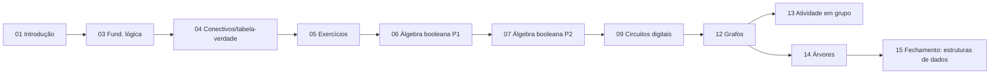

# 🗓️ Turma 2026.2 — Cronograma semanal

!!! info "O que é esta trilha"
    Esta seção segue o **calendário real do semestre** — na ordem em que os
    encontros acontecem, incluindo aulas de busca ativa e atividades. Ela é
    **independente** da trilha **[📖 Aulas](../aulas/01-aula.md)**, organizada
    por tópico. Vários temas aqui reaparecem lá com mais profundidade — use
    os links cruzados de cada aula para aprofundar.

!!! note "Avaliações A1 e A3"
    As avaliações individuais (A1) e a atividade aplicada (A3) são tratadas
    em material didático separado, fora deste cronograma. Aqui só aparece a
    **atividade avaliativa em grupo**, feita em sala.

!!! danger "Placeholders de data e logística"
    A página da atividade em grupo traz estrutura e conteúdo prontos, mas
    **datas, pesos e regras específicas** devem ser ajustados pelo professor
    conforme o plano de ensino oficial.

!!! note "Por que 'Busca Ativa' e não 'Feriado'"
    As datas de Carnaval e Tiradentes fazem parte do calendário do semestre
    **2026.1**, não do semestre atual (**2026.2**). Por isso, os encontros
    02 e 10 deixam de ser dias sem aula e passam a ser aulas de
    **[Busca Ativa](02-aula.md)** — encontros dedicados a identificar e
    reengajar alunos atrasados ou ausentes, antes que o problema se agrave.

## 🗺️ Cronograma completo

| # | Encontro | Tipo |
| :-: | :--- | :--- |
| [01](01-aula.md) | Introdução e apresentação da UC | Conteúdo |
| [02](02-aula.md) | Busca Ativa — Início de Semestre | Busca Ativa |
| [03](03-aula.md) | Fundamentos de lógica | Conteúdo |
| [04](04-aula.md) | Proposições lógicas e tabela-verdade dos conectivos | Conteúdo |
| [05](05-aula.md) | Aplicação das tabelas-verdade em exercícios | Conteúdo |
| [06](06-aula.md) | Álgebra Booleana e suas aplicações — Parte 1 | Conteúdo |
| [07](07-aula.md) | Álgebra Booleana e suas aplicações — Parte 2 | Conteúdo |
| [08](08-aula.md) | Aula de atividades e/ou prática de aplicação — Parte 1 | Prática |
| [09](09-aula.md) | Introdução a circuitos digitais | Conteúdo |
| [10](10-aula.md) | Busca Ativa — Meio de Semestre | Busca Ativa |
| [11](11-aula.md) | Aula de atividades e/ou prática de aplicação — Parte 2 | Prática |
| [12](12-aula.md) | Introdução a Grafos | Conteúdo |
| [13](13-aula.md) | Atividade avaliativa em grupo na sala | Avaliação |
| [14](14-aula.md) | Estudo de Árvore | Conteúdo |
| [15](15-aula.md) | Matemática em estrutura de dados e na aplicação em algoritmos | Fechamento |

## 🧭 Como os temas se conectam

- **Lógica → Álgebra booleana**: tabelas-verdade viram álgebra sobre
  $\{0,1\}$.
- **Álgebra booleana → Circuitos**: expressões simplificadas viram portas
  físicas.
- **Circuitos/Lógica → Grafos**: dependências e regras compostas podem ser
  modeladas como grafos dirigidos (veja a
  [atividade em grupo](13-aula.md)).
- **Grafos → Árvores**: árvore é um grafo especial, conexo e sem ciclos.
- **Tudo → Fechamento**: a [Aula 15](15-aula.md) conecta cada tema a uma
  estrutura de dados ou algoritmo real.

## ✅ Avaliação neste cronograma

| Instrumento | Aula de referência |
| :--- | :--- |
| **Atividade em grupo** — feita em sala | [Aula 13](13-aula.md) |

!!! tip "Comece pela Aula 01"
    Se esta é sua primeira visita, comece por
    **[01. Introdução e apresentação da UC](01-aula.md)**.
